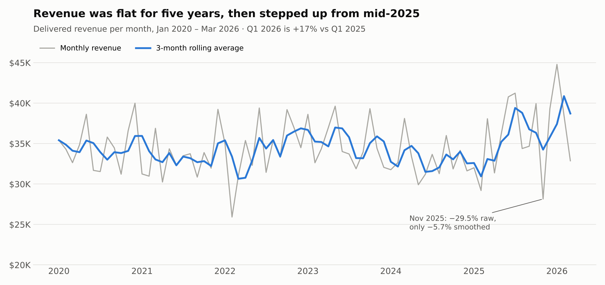
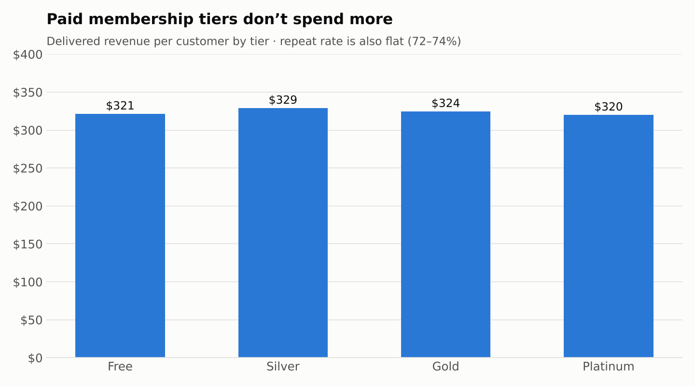
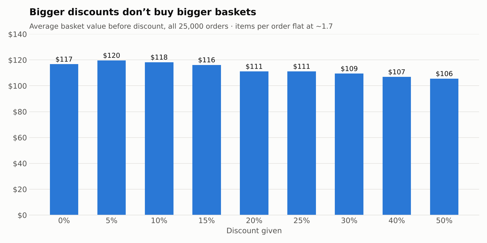
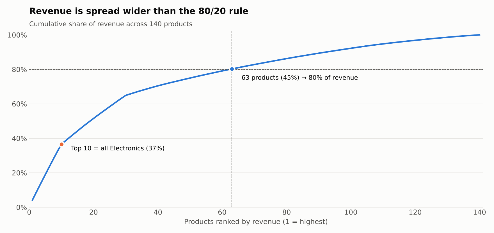

# E-commerce Customer Intelligence — SQL Analytics

**An end-to-end SQL analysis of an e-commerce business: 8,000 customers, 25,000 orders, 140 products and 75 months of revenue (2020–2026), built in PostgreSQL.**

The project asks the questions a product team would ask — *who are our customers, what drives their value, where is revenue won or lost, and how is the business trending* — and answers each with a tested SQL query. It starts with a data audit, because two of the dataset's most obvious columns turned out to be unreliable, and every finding is built only on data that passed that audit.

*Author: [Jahnavi Bonu](https://www.linkedin.com/in/jahnavi-bonu)*

---

## Key findings

| # | Finding | Evidence |
|---|---|---|
| 1 | **Revenue is accelerating after five flat years.** Annual revenue held at ~$395–425K (2020–2024), then grew **+7.5% in 2025** and **+17% in Q1 2026 vs Q1 2025**. | `05` · 5.3, 5.4 |
| 2 | **Repeat customers are the business.** 78% of buyers purchase more than once and generate **92% of revenue** — $411 vs $127 per customer, with the *same* order value (~$126). Value comes from frequency, not basket size. | `02` · 2.6 |
| 3 | **Paid membership tiers don't change behaviour.** Revenue per customer is **$320–$329** and repeat rate **72–74%** across Free, Silver, Gold and Platinum. | `02` · 2.2, 2.3 |
| 4 | **Discounts are a cost, not a growth lever.** 35% of orders are discounted ($129K, 5.4% of sales), yet items per order stay flat (~1.7) and the pre-discount basket *shrinks* from $117 to $106 as discounts deepen. | `03` · 3.3 |
| 5 | **Category mix drives revenue.** All top-10 products are Electronics (37% of revenue); overall, 45% of products make 80% of revenue — flatter than the 80/20 rule. | `04` · 4.5 |
| 6 | **22% of customers are "at risk".** Using the real reorder cycle (median 366 days) instead of an arbitrary cut-off: 34% active, **22% at risk** (missed one cycle), 37% lapsed. | `02` · 2.5 |
| 7 | **The Nov 2025 crash was a blip.** Revenue fell 29.5% in one month, but the 3-month rolling average fell only 5.7% and December recovered. Electronics orders actually *rose*; customers bought cheaper items. | `05` · 5.2, 5.3 |

<p>
  
</p>
<p>
  
  
</p>
<p>
  
</p>

---

## Recommendations

1. **Win back the at-risk segment first.** 1,748 customers have missed exactly one reorder cycle; since repeat purchasing drives 92% of revenue, re-engaging them is the highest-leverage retention move.
2. **Redesign or re-test membership benefits.** Tiers show no link to spend or frequency — either the perks don't change behaviour, or tier assignment isn't tied to value.
3. **Test smaller, targeted discounts.** Blanket discounting costs 5.4% of sales with no visible basket lift; an A/B test would confirm whether discounts create incremental orders at all.
4. **Protect and grow Electronics.** It carries over a third of revenue through just 10 products — the category to defend and extend.
5. **Allocate acquisition budget by cost, not channel.** All six channels deliver statistically similar customers ($313–$337, overlapping margins of error), so cost per acquisition should decide spend.

---

## Approach

**1. Audit before analysis** — [`01_data_audit.sql`](sql/01_data_audit.sql)
Every table was reconciled against the order-level data before any finding was drawn:

| Check | Result |
|---|---|
| Order money math (price × qty − discount + shipping + tax) | ✅ 0 errors in 25,000 orders |
| `monthly_revenue` vs orders | ✅ exactly equals delivered orders ($2,585,126.50) |
| `product_summary` vs orders | ✅ exactly equals non-cancelled orders |
| `customers.total_spend_usd` / `total_orders` vs orders | ❌ 4× higher than orders; only 5% of customers match |
| `customers.registration_date` | ❌ 74% of orders are dated *before* registration |
| `customers.churned` label | ❌ doesn't reflect behaviour (churned customers spend slightly *more*) |

**Rule adopted:** all spend, frequency and churn metrics are rebuilt from `orders`. This overturned an earlier draft finding that "Platinum members spend 87% more" — an artefact of the unreliable customer-level column.

**2. Business modules**

| File | Question | Key techniques |
|---|---|---|
| [`02_customer_analytics.sql`](sql/02_customer_analytics.sql) | Who are our customers and what drives their value? | LEFT JOIN pitfalls, multi-level CTEs, `FILTER`, `LAG` + `PARTITION BY`, `PERCENTILE_CONT`, cohort retention |
| [`03_orders_operations.sql`](sql/03_orders_operations.sql) | Where is value created or lost in the order flow? | Conditional aggregation, margin-of-error reasoning |
| [`04_product_performance.sql`](sql/04_product_performance.sql) | Which products and categories drive the business? | `RANK` / `DENSE_RANK` / `ROW_NUMBER`, median quadrants, Pareto with running totals |
| [`05_revenue_trends.sql`](sql/05_revenue_trends.sql) | How is revenue moving over time? | MoM & YoY growth, window frames (`ROWS BETWEEN`), like-for-like comparisons |
| [`06_reporting_layer.sql`](sql/06_reporting_layer.sql) | One source of truth for reporting | `CREATE VIEW` (`customer_360`), executive KPI summary |

Every query carries its finding as a comment, and the executive KPI summary reconciles to each module's result.

---

## Executive KPIs

| Customers | Purchasers | Delivered revenue | Revenue / purchaser | Repeat rate | Active | At risk | AOV | Return rate | Discount cost |
|---:|---:|---:|---:|---:|---:|---:|---:|---:|---:|
| 8,000 | 7,401 | $2.59M | $349 | 78.2% | 34.0% | 21.9% | $126 | 8.1% | 5.4% |

---

## Limitations

- **The dataset appears synthetic.** Many relationships that real businesses show — tier vs spend, delivery speed vs rating, discounts vs basket size, browsing vs order value — are flat here. The analysis shows a method that would surface these effects in real data; in this dataset most are absent, and the findings say so rather than over-reading noise.
- **No acquisition-cost data**, so channel ROI can't be computed.
- **Orders contain completed purchases only**, so conversion (visitors who browsed but didn't buy) can't be measured.
- **Findings are associations, not causes.** E.g. the discount result can't show whether discounts create orders that wouldn't otherwise happen — that needs an experiment.

---

## Dataset & how to run

**Source:** [E-Commerce Customer Behavior & Sales 2020–2026](https://www.kaggle.com/datasets/meruvakodandasuraj/e-commerce-customer-behavior-and-sales-20202026) (Kaggle) — four CSVs: `customers` (8,000) · `orders` (25,000) · `product_summary` (140) · `monthly_revenue` (75).

```bash
createdb ecommerce_analytics
psql -d ecommerce_analytics -f sql/00_schema.sql
# from the folder containing the CSVs:
psql -d ecommerce_analytics -c "\copy customers FROM 'customers.csv' CSV HEADER"
psql -d ecommerce_analytics -c "\copy orders FROM 'orders.csv' CSV HEADER"
psql -d ecommerce_analytics -c "\copy product_summary FROM 'product_summary.csv' CSV HEADER"
psql -d ecommerce_analytics -c "\copy monthly_revenue FROM 'monthly_revenue.csv' CSV HEADER"
# then run sql/01 … sql/06 in order
```

Built with PostgreSQL 18 and pgAdmin 4.
